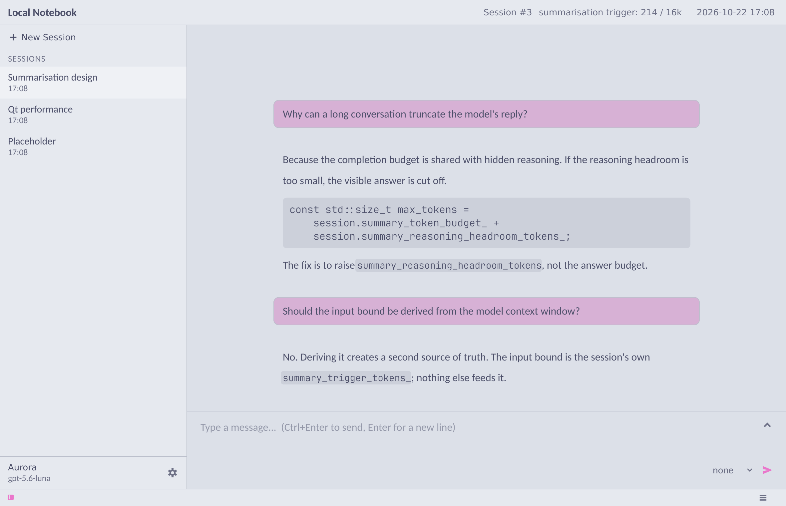
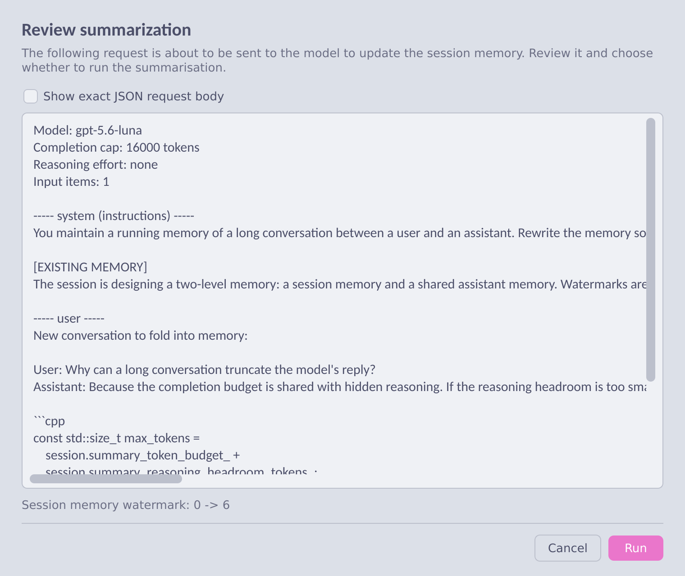

# Local Notebook

An AI client optimized to be high-performance and comfortable to be used.

<!-- TODO: replace with a 30–60s demo GIF (see docs/architecture.md for the screenshot tool) -->

---

## Download

| Platform | File |
|---|---|
| **Linux** (x86_64) | [`local-notebook-*-linux-x86_64.AppImage`](../../releases/latest) |
| **Windows** (x86_64) | [`local-notebook-*-windows-x86_64.zip`](../../releases/latest) |

---

Local Notebook is a desktop notebook for talking to a local or self-hosted model.
It runs one **assistant** per process across many **sessions**, and keeps long
conversations coherent with a **session summarization plus a shared assistant
memory** that you can open, edit and regenerate yourself.

Supports OpenAI-compatible endpoint local or remote, with optional SOCKS5
HTTP-CONNECT proxy support.

Currently, supports 3 UI languages English, 中文 and 日本語.

Supports tools:
- Searching online
- Reading (plain and regex search), Writing files in the configured shared directories

---

Two guarantees fall out of this design:

Remarks:
Summarizing twice with no new messages produces the same 
summary — because the watermarks only *count* what is new; they never decide 
what gets sent.

---

## License

MIT — see [LICENSE.txt](LICENSE.txt).
